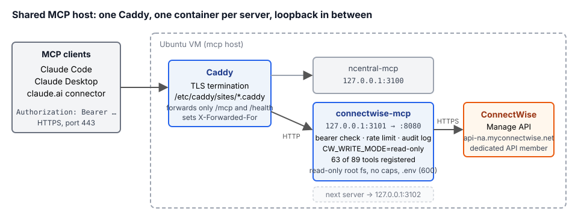

# ConnectWise Manage MCP Server

[](https://github.com/ecmsi/connectwise-manage-mcp/releases/latest)
[](https://github.com/ecmsi/connectwise-manage-mcp/actions/workflows/ci.yml)
[](LICENSE)
[](https://nodejs.org/)
[](tsconfig.json)
[](https://github.com/modelcontextprotocol/typescript-sdk)
[](#security-model)
[](https://github.com/ecmsi/connectwise-manage-mcp/commits/main)

A [Model Context Protocol](https://modelcontextprotocol.io/) server for ConnectWise Manage (PSA),
maintained by ECMSI. It gives Claude, or any MCP-compatible assistant, 90 tools over tickets, notes,
time entries, schedule entries, companies, contacts, projects, configurations, agreements, invoices,
opportunities, the product catalog and procurement, against cloud-hosted or self-hosted Manage.

It is built to run on a shared MCP host: one container per server, one TLS reverse proxy in front,
clients connecting directly with a bearer token, and nothing registered that can change PSA data
unless an operator turns it on.



## Contents

- [Quick start](#quick-start)
- [Security model](#security-model)
- [Documentation](#documentation)
- [Configuration](#configuration)
- [Available tools](#available-tools)
- [Usage](#usage)
- [Development](#development)
- [License](#license)

## Quick start

On the host, after a ConnectWise API member exists ([how to set one up](docs/API-MEMBER-SETUP.md)):

```bash
sudo mkdir -p /opt/mcp/connectwise && cd /opt/mcp/connectwise
sudo git clone --branch v2.0.0 https://github.com/ecmsi/connectwise-manage-mcp.git src
sudo cp src/docker-compose.yml compose.yml && sudo cp src/.env.example .env && sudo chmod 600 .env
# edit .env: CW_MANAGE_* from the API member, MCP_BEARER_TOKEN from `openssl rand -hex 32`
sudo docker compose build && sudo docker compose up -d
curl -s http://127.0.0.1:3101/health          # {"status":"ok"}
```

Then install the Caddy site snippet from `deploy/caddy/` and point a client at
`https://<hostname>/mcp` with the bearer token. The full procedure, including the Caddy step, client
setup, updates and troubleshooting, is in [docs/DEPLOYMENT.md](docs/DEPLOYMENT.md).

Locally, for one person on one machine:

```bash
npm ci && npm run build
CW_MANAGE_COMPANY_ID=… CW_MANAGE_PUBLIC_KEY=… CW_MANAGE_PRIVATE_KEY=… CW_MANAGE_CLIENT_ID=… node dist/index.js
```

That starts the stdio transport; see [Usage](#usage) for the Claude Desktop and Claude Code entries.

## Security model

- **The API member is the ceiling.** The server can read what its ConnectWise security role lets
  it read, and nothing more. Use a dedicated member with a role built from
  [the permission matrix](docs/PERMISSION-MATRIX.md), then run `cw_get_my_permissions` (or
  `npm run check:permissions`) to compare the member's effective permissions with what the tools
  need.
- **Read-only by default.** `CW_WRITE_MODE=read-only` registers the 64 `get`/`search`/`list`/`test`
  tools and nothing else. Write tools are not listed and cannot be called until an operator sets
  `CW_WRITE_MODE=write`. A test scans every tool's source and fails if a read-named tool ever
  issues anything but GET. This matters because ticket text is written by customers and reaches the
  model verbatim: an instruction hidden in a note cannot change PSA data when the tools that would
  do it do not exist in the process.
- **Direct clients authenticate with a bearer token.** `MCP_BEARER_TOKEN` is compared in constant
  time, must be at least 32 characters, and placeholder values are refused. HTTP refuses to start
  with no mechanism configured. A signed-gateway header (`MCP_S2S_SECRET`) and Entra ID OAuth are
  also supported; every configured mechanism is enforced.
- **Abuse controls and audit.** Per-client rate limiting, a health endpoint that discloses nothing,
  redirects refused on every ConnectWise request, upstream error bodies never forwarded or logged,
  and one log line per tool call with the tool name, outcome and duration, never its arguments.
- **Container.** Non-root, read-only root filesystem, no capabilities, memory cap, published on
  loopback only; secrets live in one `.env` with mode 600.
- **Supply chain.** `npm audit` reports nothing, for production and the full tree, and CI enforces
  it. No install-time scripts run. The embedded ticket-card bundle is reproducible from source.

## Documentation

| Document | What it covers |
|---|---|
| [docs/API-MEMBER-SETUP.md](docs/API-MEMBER-SETUP.md) | Creating the ConnectWise security role, API member, key pair and Client ID, and verifying the role from the tenant |
| [docs/PERMISSION-MATRIX.md](docs/PERMISSION-MATRIX.md) | Generated from the source: the role recipe (module, function, levels) for read-only and write mode, and what every tool needs. Every endpoint is checked against ConnectWise's published OpenAPI document |
| [docs/DEPLOYMENT.md](docs/DEPLOYMENT.md) | The shared-host layout, install, Caddy, clients, operation, updates, troubleshooting |
| [deploy/](deploy/) | Caddy site snippet and systemd unit |
| [entra-app-registration.md](entra-app-registration.md) | Entra ID app registration, only if you enable OAuth |
| [docs/ORIGIN.md](docs/ORIGIN.md) | Where the code came from and what changed at the point of divergence |
| [CHANGELOG.md](CHANGELOG.md) | Release history |

**Origin.** This project was derived on 2026-11-24 from the
[ConnectWise Manage MCP Server by WYRE Technology](https://github.com/WYRE-AI/connectwise-manage-mcp)
(Apache-2.0) and has been maintained independently since. It is not affiliated with or endorsed by
the original authors; [NOTICE](NOTICE) carries the attribution.

## Configuration

### Environment variables

| Variable | Required | Description |
|----------|----------|-------------|
| `CW_MANAGE_COMPANY_ID` | Yes | Your ConnectWise company identifier |
| `CW_MANAGE_PUBLIC_KEY` | Yes | API member public key |
| `CW_MANAGE_PRIVATE_KEY` | Yes | API member private key |
| `CW_MANAGE_CLIENT_ID` | Yes | Client ID from the [ConnectWise Developer Portal](https://developer.connectwise.com/) |
| `CW_MANAGE_URL` | No | API base URL (see below). Must be the canonical origin; redirects are refused. |
| `CW_MANAGE_REJECT_UNAUTHORIZED` | No | `false` disables TLS verification for ConnectWise requests and logs a security warning. For a private CA, leave it unset and use `NODE_EXTRA_CA_CERTS` instead. |
| `CW_WRITE_MODE` | No | `read-only` (default): 64 read tools. `write`: all 90 tools. Any other value refuses to start. |
| `MCP_TRANSPORT` | No | `stdio` (default) or `http` |
| `MCP_HTTP_PORT` | No | HTTP port (default `8080`) |
| `MCP_HTTP_HOST` | No | Bind address for HTTP (default `127.0.0.1`). Honored only when an authentication mechanism is configured. |
| `MCP_BEARER_TOKEN` | One of these for HTTP | Static bearer token every direct client sends as `Authorization: Bearer <token>`. At least 32 characters; `openssl rand -hex 32`. |
| `MCP_S2S_SECRET` | One of these for HTTP | HMAC secret for `X-Gateway-S2S`, when a signing gateway or proxy sits in front of the server. Required for `AUTH_MODE=gateway`. |
| `MCP_OAUTH_ENABLED` | One of these for HTTP | `true` turns on Entra ID OAuth 2.1 (see [entra-app-registration.md](entra-app-registration.md)). `MCP_BEARER_TOKEN` is then the static fallback inside that flow. |
| `MCP_ALLOW_INSECURE_DEV` | No | `1` starts HTTP with no authentication, bound to `127.0.0.1` only. Local development. |
| `MCP_RATE_LIMIT_PER_MINUTE` | No | Requests per minute per client address on every path except `/health`. Default `120`; `0` disables. |
| `MCP_TRUST_PROXY` | No | `1` when a reverse proxy sets `X-Forwarded-For`, so the rate limiter sees the real client. |
| `AUTH_MODE` | No | `env` (default): ConnectWise credentials from `CW_MANAGE_*`. `gateway`: credentials arrive per request on `X-CW-*` headers; needs `MCP_S2S_SECRET`. |
| `LOG_LEVEL` | No | `info` by default |

Every configured HTTP mechanism is enforced on `/mcp`. `/health` and `/healthz` stay
unauthenticated, read no credentials, and return only `{"status":"ok"}`. The stdio transport uses
none of the HTTP settings.

### HTTP authentication

**Bearer token** (the usual choice). Every `/mcp` request carries `Authorization: Bearer <MCP_BEARER_TOKEN>`.
A missing or wrong token answers `401` with a `WWW-Authenticate` header, and the failure is logged
with the client address.

**Signed gateway header.** With `MCP_S2S_SECRET` set, every `/mcp` request must include
`X-Gateway-S2S`:

```text
X-Gateway-S2S: t=<unix seconds>,v1=<hex hmac-sha256("t=<unix seconds>")>
```

`v1` is HMAC-SHA256 (hex, lowercase) of the ASCII string `t=<unix seconds>`, keyed with
`MCP_S2S_SECRET`. The timestamp must be within 300 seconds of the server clock. In
`AUTH_MODE=gateway`, `/mcp` also requires `X-CW-Company-Id`, `X-CW-Public-Key`, `X-CW-Private-Key`
and `X-CW-Client-Id` (`X-CW-Url` optional and validated against private address space).

**Entra ID OAuth** (`MCP_OAUTH_ENABLED=true`) serves the discovery routes and validates Entra JWTs on
`/mcp`.

### API base URL (`CW_MANAGE_URL`)

| Instance type | URL |
|---------------|-----|
| Cloud (North America) | `https://api-na.myconnectwise.net` (default) |
| Cloud (Europe) | `https://api-eu.myconnectwise.net` |
| Cloud (Australia) | `https://api-au.myconnectwise.net` |
| Self-hosted | `https://cwm.yourcompany.com` |

For a self-hosted instance set `CW_MANAGE_URL` to the server's canonical base URL. The server
appends `/v4_6_release/apis/3.0` unless the URL already contains that path.

### Getting your API keys

Follow [docs/API-MEMBER-SETUP.md](docs/API-MEMBER-SETUP.md): a security role built for this server,
an API member with that role, a key pair on the member, and a Client ID from the developer portal.

## Available tools

### Custom field filters

The following tools accept optional `customFieldConditions` alongside `conditions`: `cw_search_tickets`, `cw_search_projects`, `cw_search_project_tickets`, `cw_search_companies`, `cw_search_contacts`, `cw_search_configurations`, `cw_search_opportunities`, `cw_search_activities`, `cw_search_agreements`, `cw_search_invoices`, `cw_search_purchase_orders`, `cw_get_purchase_order_items`, `cw_search_procurement_products`, `cw_search_sales_orders`, `cw_get_sales_order_products`, `cw_search_catalog_items`, `cw_search_members`, `cw_search_time_entries`.

For example: `caption="Contract Type" AND value="Managed"`. Match one custom field per condition using its caption and value. Strings use double quotes; dates use square brackets (e.g. `caption="Renewal Date" AND value > [2026-01-01T00:00:00Z]`); `value != null` matches any value. Supported operators: `=`, `!=`, `<`, `<=`, `>`, `>=`, `contains`, `like`, `not`. The parameter is sent unchanged and omitted when undefined or an empty string.

### Interactive Ticket Card (MCP Apps)

`cw_get_ticket` renders as an interactive card in MCP Apps hosts
(Claude Desktop/web) with an in-card "Add note" round-trip via
`cw_add_ticket_note` that always posts internal-only (`internalAnalysisFlag`)
notes; plain-JSON behavior is unchanged in other hosts. The card is neutral by
default and brandable via `window.__BRAND__` injection or `MCP_BRAND_*` env
vars (`MCP_BRAND_NAME`, `MCP_BRAND_LOGO_URL`, `MCP_BRAND_PRIMARY_COLOR`,
`MCP_BRAND_ACCENT_COLOR`, `MCP_BRAND_BG`, `MCP_BRAND_TEXT`) — no rebuild
needed.

### Tickets
- `cw_search_tickets` — Search service tickets with `conditions` and `customFieldConditions`
- `cw_get_ticket` — Get a ticket by ID
- `cw_get_ticket_configurations` — List configuration references associated with a service ticket (paged)
- `cw_update_ticket_configurations` — Add/remove ticket configuration associations in an ordered batch, reporting every outcome
- `cw_create_ticket` — Create a new service ticket. Optional `parentTicketId` (the same field `cw_get_ticket` returns) creates the ticket as a child of that parent. Optional `siteId` (see `cw_list_company_sites`) and `ownerId` (a member id) set the site and owner at creation. `automaticEmailContactFlag`, `automaticEmailResourceFlag` and `automaticEmailCcFlag` are opt-in and sent only when set; the board's own new-ticket notification settings in Manage still apply.
- `cw_update_ticket` — Update a ticket (JSON Patch)
- `cw_bundle_tickets` — Write. Bundle tickets by attaching one or more child tickets to a parent in one `POST /service/tickets/{parentTicketId}/attachChildren` call. A child already bundled under another parent is moved to the new parent. Does not merge ticket contents.
- `cw_get_ticket_notes` — Get all notes on a ticket (including child ticket notes)
- `cw_add_ticket_note` — Add a note to a ticket (discussion, internal, or resolution). **Nothing is emailed unless `processNotifications` is true.** `emailContactFlag`, `emailResourceFlag`, `emailCcFlag`, and `emailCc` are not ServiceNote fields and are not sent (posting them is a ConnectWise 400). A true flag only turns on `processNotifications`. Recipients come from the ticket `automaticEmailContactFlag`, `automaticEmailResourceFlag`, `automaticEmailCcFlag`, and `automaticEmailCc`. Optional `memberId` is sent as `member.id` and sets the author; omit it and Manage attributes the note to the API member. The create response reports `internalFlag` / `externalFlag` from the note type that was stored, so an internal note is not also reported as external.

### Companies
- `cw_search_companies` — Search companies
- `cw_get_company` — Get a company by ID
- `cw_list_company_sites` — List a company's sites (`GET /company/companies/{id}/sites`) to find the site id for `cw_create_contact` and `cw_create_ticket`
- `cw_create_company` — Create a new company
- `cw_update_company` — Update a company (JSON Patch)

### Contacts
- `cw_search_contacts` — Search contacts. Filter contact type with `typeName`, `typeId`, or `childConditions` (for example `types/name = "Primary"`). `types` / `types/name` in `conditions` is invalid and returns 400 `ApiFindCondition` because type is a child collection; the tool moves those clauses to `childConditions`. Contacts have `firstName` and `lastName`, not `name`. String values use double quotes (`firstName = "Ada"`); single quotes are accepted and rewritten.
- `cw_get_contact` — Get a contact by ID
- `cw_create_contact` — Create a new contact. Communication type names vary per tenant, so the email and phone types are resolved from `GET /company/communicationTypes` (`emailFlag` / `phoneFlag`, cached for 10 minutes per connection) instead of assuming "Email" / "Direct". Optional `emailTypeId`, `emailTypeName`, `phoneTypeId`, `phoneTypeName` override the lookup (an id wins over a name; an unknown name lists the available types). Optional `siteId` places the contact on a specific company site; omit it to use the company's default site.
- `cw_list_communication_types` — List the tenant's communication types (`GET /company/communicationTypes`) to find the ids for `cw_create_contact` and `cw_update_contact`
- `cw_update_contact` — Update a contact (JSON Patch on `PATCH /company/contacts/{id}`). Paths include `firstName`, `lastName`, `title`, `inactiveFlag`, `site`, `communicationItems` (email and phone; use `type: { id }` from `cw_list_communication_types`, since type names vary per tenant), and `customFields`. Contact types are not on this patch.
- `cw_update_contact_types` — Add or remove a contact type such as "Decision Maker" (`POST` / `DELETE /company/contacts/{id}/typeAssociations`). Adding a type the contact already has does not create a duplicate.

### Projects
- `cw_search_projects` — Search projects. Open projects only by default (`closedFlag = false`); pass `activeOnly: false` for closed ones, and `fields` to trim the payload
- `cw_get_project` — Get a project by ID
- `cw_create_project` — Create a new project
- `cw_search_project_tickets` — Search tickets under a project
- `cw_get_project_ticket` — Get a specific project ticket by ID
- `cw_get_project_ticket_notes` — Get all notes on a project ticket (including child ticket notes)
- `cw_add_project_ticket_note` — Add a note to a project ticket (discussion, internal, or resolution). Email flags are not sent. Optional `memberId` sets the author (`member.id`).

### Time Entries
- `cw_search_time_entries` — Search time entries
- `cw_get_time_entry` — Get a time entry by ID
- `cw_create_time_entry` — Create a new time entry. ConnectWise ignores the entry's `emailContactFlag`, `emailResourceFlag`, and `emailCcFlag` on create and copies the ticket's `automaticEmail*` flags instead. For service and project tickets, each email flag left false (the default) has its matching ticket flag turned off for the create and then restored. If that toggle fails, the entry is not created. `suppressTicketAutoEmail: false` turns the toggle off. See [Notes, time entries and customer email](#notes-time-entries-and-customer-email).
- `cw_update_time_entry` — Correct a time entry (JSON Patch on `PATCH /time/entries/{id}`). Use this to fix `actualHours` when a metered agreement rounds to 0.25.
- `cw_delete_time_entry` — Delete a time entry (`DELETE /time/entries/{id}`). Manage rejects deletes of entries that are already billed.

### Schedule Entries
- `cw_search_schedule_entries` — Search booked resource time
- `cw_list_schedule_types` — List schedule types (Service, Project, Sales, Meeting)
- `cw_list_schedule_statuses` — List schedule statuses (Tentative, Firm)
- `cw_create_schedule_entry` — Book resource time against a ticket, activity or project ticket
- `cw_update_schedule_entry` — Update a schedule entry (JSON Patch)

### Members
- `cw_search_members` — Search members/technicians
- `cw_get_member` — Get a member by ID

### Configuration Items
- `cw_search_configurations` — Search configuration items (assets)
- `cw_get_configuration` — Get a configuration item by ID

### Service Reference Data
- `cw_list_boards` — List service boards
- `cw_list_priorities` — List ticket priorities
- `cw_list_statuses` — List statuses for a board

### Activities
- `cw_search_activities` — Search activities
- `cw_get_activity` — Get an activity by ID
- `cw_create_activity` — Create a new activity

### Agreements
- `cw_search_agreements` — Search agreements
- `cw_get_agreement` — Get an agreement by ID
- `cw_get_agreement_additions` — Get additions (line items) on an agreement
- `cw_update_agreement_addition` — Update an addition with JSON Patch (quantity, effectiveDate, cancelledDate, billCustomer, etc.); supports a `dryRun` preview that makes no write
- `cw_create_agreement_addition` — Create a new addition on an agreement
- `cw_search_agreement_recaps` — Search agreement billing recaps (used, remaining, overrun, next invoice)
- `cw_get_agreement_recap` — Get the billing recap for one agreement

### Invoices
- `cw_search_invoices` — Search invoices (CW `conditions`, `orderBy` e.g. `id desc`)
- `cw_get_invoice` — Get an invoice by ID
- `cw_update_invoice` — Update one invoice with JSON Patch (`PATCH /finance/invoices/{id}`); returns the updated invoice in the same shape as `cw_get_invoice`. Allowed paths (leading slash optional): `status/id` or `status` (`{ id }`), `attention`, `dueDate`, `date`, `reference`, `customerPO`, `internalNotes`, `billToCompany` and `billingSite` (each as `{ id }` or via `/id`; `billToSite` is accepted as an alias for Manage's `billingSite`). Manage invoices have no `billToContact` field — use `attention` for the contact name. Custom and payment fields are rejected before Manage is called. `dryRun: true` GETs the invoice, applies the patch in memory, and returns `{ dryRun: true, saved: false, preview }` with no write. No batch mode — loop over ids (concurrency 3–5) and report per invoice. Resolve billing status names to ids first; never guess an id. Manage 400/401/403/404/409 errors pass through; 429 is retried once, and 5xx is retried once only when every operation is replace (a PATCH that includes add or remove retries only on 429). Requires the API member's role to have **Finance › Invoices: Edit**.

### Procurement
- `cw_search_purchase_orders` — Search purchase orders
- `cw_get_purchase_order` — Get a purchase order by ID
- `cw_get_purchase_order_items` — Get the line items on a purchase order
- `cw_search_procurement_products` — Search procurement product items (SKUs placed on a ticket, project, order or opportunity)
- `cw_get_procurement_product` — Get a procurement product item by ID
- `cw_get_project_product_status` — For a project or ticket, every product with ordered, picked (received and allocated), shipped and awaiting quantities and a status (`in_stock`, `partially_received`, `awaiting_arrival`, `awaiting_pick`, `not_ordered`, `shipped`, `not_stocked`, `cancelled`), with matching purchase order lines and receipts
- `cw_get_project_purchase_order_lines` — Purchase order lines and receipts (received quantity, received status, date received, tracking) for the products on a project or ticket

ConnectWise gives a purchase order line no project or ticket reference, so the two project tools match lines on the customer's purchase orders by sales order, else by customer company and catalog item. Each matched line says which (`matchedBy`).

### Sales Orders
- `cw_search_sales_orders` — Search sales orders
- `cw_get_sales_order` — Get a sales order by ID
- `cw_get_sales_order_products` — Get the product items on a sales order

### Opportunities
- `cw_search_opportunities` — Search opportunities
- `cw_get_opportunity` — Get an opportunity by ID
- `cw_search_opportunity_forecasts` — Search opportunity forecast lines
- `cw_search_opportunity_notes` — Search notes on an opportunity
- `cw_search_sales_stages` — List sales pipeline stages

### Catalog (Products)
- `cw_search_catalog_items` — Search product catalog items
- `cw_get_catalog_item` — Get a catalog item by ID
- `cw_create_catalog_item` — Create a new catalog item
- `cw_update_catalog_item` — Update a catalog item (JSON Patch)
- `cw_list_catalog_categories` — List catalog categories
- `cw_list_catalog_subcategories` — List catalog subcategories
- `cw_list_manufacturers` — List manufacturers

### Procurement Inventory
Warehouse stock and Inventory Adjustments. An adjustment is the only supported way to change on-hand quantities through the API: create the header, add the lines, then close it to post.
- `cw_list_warehouses` — List inventory warehouses
- `cw_list_warehouse_bins` — List warehouse bins, optionally for one warehouse
- `cw_get_inventory_on_hand` — Report every item with non-zero on-hand per bin, negatives included, with unit cost and extended value. With `catalogItemId` it reads that item's own inventory list instead of walking bins
- `cw_get_catalog_item_inventory` — On-hand stock for one catalog item (by ID or SKU), per warehouse bin, with the total
- `cw_list_adjustment_types` — List inventory adjustment types
- `cw_create_adjustment` — Create an adjustment header (moves no stock)
- `cw_add_adjustment_detail` — Add one signed adjustment line, with serial numbers for serialised items
- `cw_get_adjustment` — Get an adjustment header with all of its detail lines
- `cw_close_adjustment` — Post the adjustment. **Not reversible except by a counter-adjustment**

**Security role permissions.** Warehouses, warehouse bins and adjustment types are ConnectWise setup tables, so `cw_list_warehouses`, `cw_list_warehouse_bins`, `cw_list_adjustment_types` and the whole-instance bin scan in `cw_get_inventory_on_hand` need **System › Table Setup** (Inquire) with the Inventory / Warehouse, Warehouse Bin and Adjustment Type tables allowed. Procurement › Inventory Adjustments, Inventory Transfers or Product Catalog access does not cover them. `cw_get_catalog_item_inventory` (and `cw_get_inventory_on_hand` with `catalogItemId`) need only **Procurement › Product Catalog**. Product items need **Procurement › Products**, which is separate from Product Catalog, and purchase orders need **Procurement › Purchase Orders**. When ConnectWise refuses a call for a missing permission, the error names the module and permission to grant.

Two limits of the ConnectWise API are worth knowing before using these. There is no `summary` field on an adjustment: the free-text fields are `reason` (max 100 characters) and `notes`. And no endpoint exposes an average cost, so the `unitCost` reported by `cw_get_inventory_on_hand` is the catalog item's own `cost` field, which is the standing cost rather than the weighted average cost ConnectWise values the stock at.

### Health
- `cw_test_connection` — Test connection (hits `/system/info`)

### Notes, time entries and customer email

- **The ticket decides who gets emailed.** ConnectWise sends email to the recipients set by the ticket's Automatic Email flags: `automaticEmailContactFlag`, `automaticEmailResourceFlag`, `automaticEmailCcFlag`, and the `automaticEmailCc` addresses.
- **Time entries.** ConnectWise has no per-entry override for these emails. On create, it ignores the entry's `emailContactFlag`, `emailResourceFlag`, and `emailCcFlag`, copies the ticket's flags onto the new entry, and emails accordingly. To keep a recipient off the email, `cw_create_time_entry` turns that ticket flag off for the instant of the create and then turns it back on. This happens for every entry flag that is false (the default) where the ticket flag is on.
  - If the ticket can't be read or the flag can't be turned off (for example, the API member can't edit tickets), the entry is **not created**.
  - Turning the flags back on is retried: up to 3 attempts, 200 ms and then 600 ms apart, so a transient ConnectWise error does not leave them off.
  - If every attempt fails after the entry was created, the result is **not** an error, because the entry exists and must not be created again (an error result invites a retry, which would log the time twice). The first content item is a `WARNING` that the time entry WAS created, with its id, followed by one line per ticket flag left off. The entry JSON comes next. The last item is a JSON status block: `timeEntryCreated: true`, `timeEntryId`, `autoEmailRestoreFailed: true`, `ticketId`, `flagsLeftOff`, `restoreAttempts` and `restoreWith`. Until the flags are turned back on (`cw_update_ticket`, or `PATCH /project/tickets/{id}` for a project ticket), ConnectWise does not auto-email those recipients for that ticket.
  - The server also writes one error-level JSON line to stderr (`"event":"cw_time_entry_auto_email_restore_failed"`) with the ticket id and path, `flagsLeftOff`, `timeEntryCreated`, `timeEntryId`, the attempt count, the connection identity (API base URL + company id) and the sanitized ConnectWise error (status and reference id). It never contains keys or credentials.
  - If the create itself fails and the restore also fails, the result is an error that says creation failed or could not be confirmed (the POST may have reached ConnectWise before the error, so check ConnectWise for the entry before retrying) and names the flags left off, and the same log line is written with `timeEntryCreated: false` (meaning the create was not confirmed). The same retry and log apply when turning the flags off fails partway and they have to be put back.
  - Concurrent `cw_create_time_entry` calls on the same ticket are queued one at a time (read, toggle, post, restore), keyed by the ConnectWise connection (API base URL + company id) and the ticket. **This lock is in-process only:** it covers parallel calls within one stdio server, one Node HTTP server, or one Worker isolate. It does not coordinate across replicas, separate Worker isolates, or other tools and people editing the same ticket, so a create from elsewhere during the window can still be emailed. Creates on different tickets still run in parallel. **Run the HTTP server as a single replica** when concurrent creates on one ticket are possible. With more than one replica, or on Cloudflare Workers where requests can land in different isolates, two creates on the same ticket can interleave, so one entry can be posted after the other has turned the flags back on (that recipient is emailed), or one can read the other's "off" state as the original and leave the flags off.
  - During that brief window, other entries logged on the same ticket also miss auto-email. The ticket PATCH also updates the ticket's `lastUpdated`, and that can fire ticket-update workflow rules.
  - Pass `suppressTicketAutoEmail: false` to skip the toggle and keep ConnectWise's default behaviour. Entries charged to a charge code or an activity never touch a ticket.
- **Notes.** A ticket note emails only when `processNotifications` is true on the note **and** the matching ticket Automatic Email flag is on. `cw_add_ticket_note` sets `processNotifications` when you pass `emailContactFlag`, `emailResourceFlag`, or `emailCcFlag` as true, unless you set `processNotifications` yourself. Those flag names are never posted on the note itself.
- **No per-note recipients.** The ConnectWise note API can't take recipients or CC addresses for an individual note. To change who gets a note's email, change the ticket's Automatic Email flags and `automaticEmailCc` (for example with `cw_update_ticket`) before adding the note.

## Usage

### Hosted (HTTP) with Claude Code

```bash
claude mcp add --transport http connectwise https://cw-mcp.example.com/mcp \
  --header "Authorization: Bearer <MCP_BEARER_TOKEN>"
```

Or in `.mcp.json`:

```json
{
  "mcpServers": {
    "connectwise": {
      "type": "http",
      "url": "https://cw-mcp.example.com/mcp",
      "headers": { "Authorization": "Bearer <MCP_BEARER_TOKEN>" }
    }
  }
}
```

### Local (stdio) with Claude Desktop or Claude Code

Build once (`npm ci && npm run build`), then point the client at the checkout. Claude Desktop's
`claude_desktop_config.json`:

```json
{
  "mcpServers": {
    "connectwise-manage": {
      "command": "node",
      "args": ["/absolute/path/to/connectwise-manage-mcp/dist/index.js"],
      "env": {
        "CW_MANAGE_COMPANY_ID": "your-company-id",
        "CW_MANAGE_PUBLIC_KEY": "your-public-key",
        "CW_MANAGE_PRIVATE_KEY": "your-private-key",
        "CW_MANAGE_CLIENT_ID": "your-client-id",
        "CW_WRITE_MODE": "read-only"
      }
    }
  }
}
```

For a self-hosted instance add `"CW_MANAGE_URL": "https://cwm.yourcompany.com"`, and for a private
CA add `"NODE_EXTRA_CA_CERTS": "/path/to/ca-bundle.pem"` rather than turning verification off.
Keeping credentials out of the client file is better still: `node --env-file=/path/to/.env
.../dist/index.js` reads them from a file only you can open.

### With Docker

`docker-compose.yml` is the shared-host shape: credentials and the bearer token from a `.env`
beside it, published on `127.0.0.1:3101`, read-only root filesystem, no capabilities, memory cap,
`MCP_TRUST_PROXY=1` for the reverse proxy in front.

```bash
cp .env.example .env && chmod 600 .env   # fill in CW_MANAGE_* and MCP_BEARER_TOKEN
docker compose build
docker compose up -d
curl -s http://127.0.0.1:3101/health     # {"status":"ok"}
```

The container refuses to start until `MCP_BEARER_TOKEN` (or another mechanism) is set, so the
listener is never reachable unauthenticated. [docs/DEPLOYMENT.md](docs/DEPLOYMENT.md) covers the
rest: the Caddy site, client setup, operation, updates and troubleshooting.

## Development

```bash
npm ci              # install
npm run build       # compile to dist/
npm run dev         # tsc --watch
npm run build:ui    # rebuild the embedded ticket card (only when ui/ changes)
npm run lint
npm run typecheck
npm test
npm run check       # everything CI runs, including the production audit
```

Local HTTP without a token, loopback only:

```bash
MCP_TRANSPORT=http MCP_ALLOW_INSECURE_DEV=1 npm start
```

## Contributing

See [CONTRIBUTING.md](CONTRIBUTING.md). Run `npm run check` before opening a pull request.

## License

Apache-2.0. See [LICENSE](LICENSE) and [NOTICE](NOTICE).

This project is derived from the ConnectWise Manage MCP Server by WYRE Technology
([WYRE-AI/connectwise-manage-mcp](https://github.com/WYRE-AI/connectwise-manage-mcp), Apache-2.0),
which in turn credits community contributions from Tekscape and Cloudwize Technologies for the
procurement and agreement-recap tools. ECMSI maintains this version independently.
