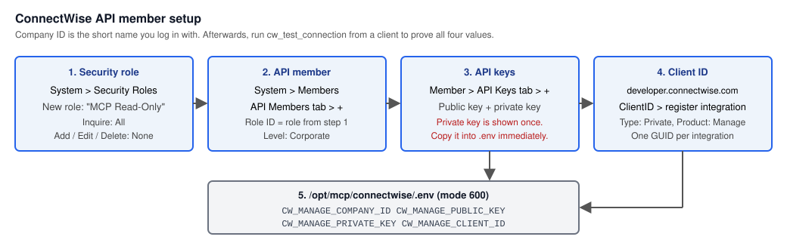

# Setting up the ConnectWise API member

Everything this server can do, it does as one ConnectWise Manage **API member**. The member's
security role is the ceiling: the model can read exactly what the role lets the member read, and in
write mode can change exactly what the role lets the member change. So the setup is, in order, a
role, a member with that role, a key pair for the member, and a Client ID for the integration. The
last step verifies the role from the tenant itself.



Four values come out of this, and they are the only ConnectWise settings the server needs:

| `.env` variable | Where it comes from |
|---|---|
| `CW_MANAGE_COMPANY_ID` | The short company name you type on the Manage login screen |
| `CW_MANAGE_PUBLIC_KEY` | Step 3 |
| `CW_MANAGE_PRIVATE_KEY` | Step 3 (shown once) |
| `CW_MANAGE_CLIENT_ID` | Step 4 |

You need a Manage login with rights to System > Security Roles and System > Members (an
administrator role), and a developer-portal account for step 4.

## 1. Create a security role for the server

Do not reuse Admin, and do not reuse a technician's role. A role of its own means the permission
list is exactly what the server needs, is auditable on one screen, and can be widened later without
touching anyone else.

1. In Manage, open **System > Security Roles**.
2. Click **+** (New). Name the role `MCP Read-Only` and save it.
3. Open the role. Each module expands to a list of functions, and each function has four access
   levels: **Add**, **Edit**, **Delete** and **Inquire**. Each level is **All**, **My** or **None**.
4. Apply the **MCP Read-Only** recipe from [PERMISSION-MATRIX.md](PERMISSION-MATRIX.md): every
   function listed there gets **Inquire: All**, and nothing else is changed. Everything not listed
   stays at None. The recipe also names the **System > Table Setup** tables to allow; when you set
   Inquire on Table Setup, Manage asks which setup tables the role may read.
5. Save.

Why the matrix is the reference and not a table here: it is generated from the server's source
(`src/permission-matrix.ts`), so it changes when the tools change, and the test suite checks every
endpoint behind it against ConnectWise's published API document. Each row also lists the tools that
need it, so you can skip a function if you will never use those tools.

A note on names. ConnectWise does not publish which security function each REST endpoint checks, and
the row names on the Security Roles screen can differ a little between Manage releases. The matrix
uses the names current releases show, confirmed against integration vendors' published matrices
where they list the same rows. If a row in your tenant is worded differently, pick the nearest match
and let step 5 settle it: the live check names every function it could not find and lists the rows
that do exist in that module.

### If you later need write mode

Create a **second** role (`MCP Write`) rather than widening the first, and a second API member for
it, so the two servers in `DEPLOYMENT.md` ("Write mode") run as different members and Manage's audit
trail can tell them apart. Apply the **MCP Write** recipe from
[PERMISSION-MATRIX.md](PERMISSION-MATRIX.md), which adds Add, Edit and (for time entries only)
Delete on the functions the write tools touch. Two things in it deserve a second look before you
grant them: `cw_create_time_entry` needs Edit on Service Tickets and Project Tickets because it
briefly turns a ticket's automatic-email flags off around the create so customers are not emailed;
and `cw_close_adjustment` posts stock movements that can only be reversed with a counter adjustment.

## 2. Create the API member

1. Open **System > Members**.
2. Switch to the **API Members** tab (it sits next to the Members tab at the top of the list).
3. Click **+** (New).
4. Fill in the member:

   | Field | Value |
   |---|---|
   | Member ID | `mcp-readonly` (or anything short; this is the member's login name, not a password) |
   | Member Name | `MCP Server (read-only)` |
   | Role ID | `MCP Read-Only` from step 1 |
   | Level | Corporate |
   | Name | the same as Member Name |
   | Location / Business Unit (Department) | your main location and department |
   | Default Territory | your main territory |
   | Time Zone | the tenant's time zone |

   Leave the rest at defaults. An API member has no password and cannot log in interactively, and
   it does not consume a Manage license.
5. Save. The member record reopens with more tabs.

Make a separate member (and role) for the write-mode server if you deploy one; do not share one
member between servers.

## 3. Generate the API keys

1. On the API member record, open the **API Keys** tab.
2. Click **+** (New).
3. Enter a **Description** that says where the key lives, for example `mcp01 /opt/mcp/connectwise`.
4. Save. Manage shows the **Public Key** and the **Private Key**.
5. Copy both into the host's `.env` now (`CW_MANAGE_PUBLIC_KEY`, `CW_MANAGE_PRIVATE_KEY`). **The
   private key is displayed once.** After you leave the screen it cannot be shown again; a lost
   private key means generating a new pair and deleting the old one.

Rotation is the same screen: add a new pair, update `.env`, recreate the container
(`docker compose up -d`), then delete the old pair. Deleting a key pair revokes it immediately.

## 4. Get a Client ID

ConnectWise requires every API integration to identify itself with a Client ID GUID, sent on each
request as the `clientId` header. It is tied to the integration, not to a member or a tenant, so one
Client ID can serve both the read-only and the write-mode servers.

1. Go to <https://developer.connectwise.com/> and sign in. If you do not have an account, register
   with the same company email address you use for Manage; partner accounts are tied to the
   company's Manage tenant.
2. Open **ClientID** from the top navigation (<https://developer.connectwise.com/ClientID>).
3. Register a new integration:

   | Field | Value |
   |---|---|
   | Integration name | `ECMSI MCP Server` |
   | Description | `MCP server for Claude, read-only by default` |
   | Integration type | Private (for your own company only) |
   | Product | Manage / PSA |

4. The portal shows the GUID. Copy it into `.env` as `CW_MANAGE_CLIENT_ID`.

A Client ID is not a secret in the way the private key is, but treat it as one: it is part of what
authenticates every call, and `.env` is mode 600 anyway.

## 5. Verify from the tenant

Fill the four values into `/opt/mcp/connectwise/.env` and start the container
(`docker compose up -d`). Then, from a connected client:

1. **`cw_test_connection`** calls `/system/info` and returns the tenant's version and licence
   summary. That proves the company ID, both keys and the Client ID.
2. **`cw_get_my_permissions`** calls `/system/mySecurity`, which returns the member's own effective
   permissions, and compares them with the recipe for the server's write mode. The result lists
   every module and function whose required level is not All, which tools that blocks, and, for a
   function it could not find by name, the rows that do exist in that module so you can spot a
   renamed row. Pass `writeMode: "write"` to check a member meant for the write-mode server, or
   `includeRows: true` to see every row the member has.

The same check runs on the host without a client, against the compiled code:

```bash
cd /opt/mcp/connectwise/src && sudo node --env-file=../.env scripts/check-permissions.mjs
# add --mode write for the write-mode member, --rows to print every permission row
```

It exits 1 while any gap remains. Grant what it names on the role, save, and run it again; no restart
is needed, the role change applies to the member's next request.

`mySecurity` does not show which Table Setup tables a role allows, so the report lists the tables to
allow and leaves that to the role screen. A refused call still names the table in its error:

```
ConnectWise API GET /procurement/warehouses returned 403 (reference 2f6c…) ConnectWise refused this for lack of
a security role permission: grant the API member's security role System > Table Setup (Inquire), with the
Inventory / Warehouse setup table allowed (System > Security Roles).
```

## What to keep where

| Item | Where | Who can see it |
|---|---|---|
| Private key | `.env` on the host only | root and the container |
| Public key, Client ID, company ID | `.env` on the host | same |
| Role definition | Manage, System > Security Roles | Manage administrators |
| Key description | Manage, the member's API Keys tab | names the host so a stray key can be traced |

Never paste the private key into a chat, a ticket, a client config file or a compose file. If it
has been exposed, generate a new pair and delete the old one; that revokes it immediately.

## Reference

The navigation above matches the ConnectWise Manage client as of 2026 and is consistent with the
setup guides ConnectWise integration partners publish, for example
[Acronis](https://www.acronis.com/en/support/documentation/ConnectWisePSA/creating-api-member-in-connectwise-manage.html),
[N-able](https://documentation.n-able.com/passportal/userguide/Content/psa-integ/cwpsa-create-api-member.htm) and
[Sophos](https://docs.sophos.com/central/partner/help/en-us/ConnectWiseIntegration/SetUpIntegration/ConnectWiseSetup/).
Row names in the matrix were cross-checked against the permission lists published by
[Kaseya ConnectBooster](https://help.cb.kaseya.com/help/Content/configure-connectwise-manage-integration-with-less-than-admin-permissions.htm),
[QuoteWerks](https://tickets.quotewerks.com/support/solutions/articles/9000232395-connectwise-psa-manage-minimum-security-permissions-for-quotewerks),
[N-able N-central](https://documentation.n-able.com/N-central/userguide/Content/Administration/PSA_Integration/ConnectWise/PSA_ConnectWise_Member_Permissions.htm) and
[CyberFOX](https://support.cyberfox.com/360028783331-ConnectWise-Manage-Permissions-for-API-Member-Security-Role).
The Client ID registration is described on the
[ConnectWise developer network](https://developer.connectwise.com/Getting_Started). Those pages have
screenshots of the Manage screens; they are not reproduced here because they belong to their authors
and because Manage's UI changes between releases.
